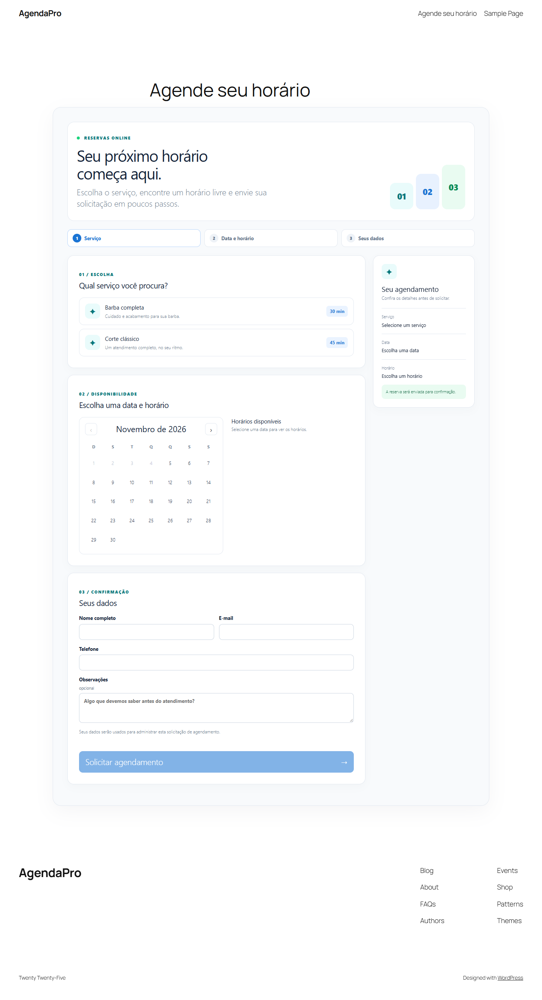
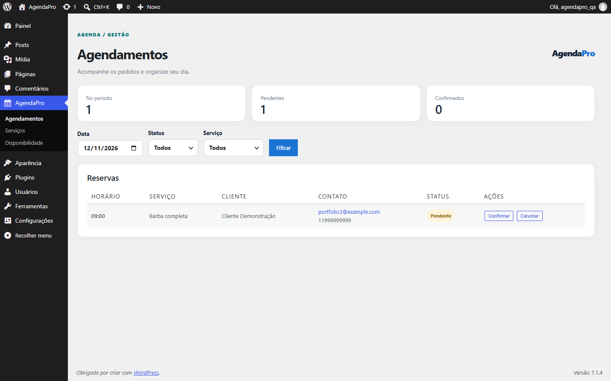

# AgendaPro — Plugin WordPress de Agendamentos

Projeto autoral demonstrativo para pequenos negócios que atendem com hora marcada. O visitante escolhe serviço, data e horário; o administrador acompanha as solicitações no WordPress.

## Funcionalidades implementadas

- Serviços com duração, intervalo após o atendimento, descrição e estado ativo.
- Expediente com múltiplos intervalos por dia e bloqueio de datas.
- Disponibilidade com antecedência mínima de 60 minutos e passos de 30 minutos.
- Shortcode `[agendapro_booking]` com interface responsiva.
- Solicitação pública com status pendente, validação no servidor, honeypot e limite de tentativas por IP.
- Bloqueio de escrita MySQL por agenda durante a verificação e gravação de uma reserva.
- Painel para filtrar agendamentos e confirmar, cancelar ou concluir.
- Endpoints REST públicos e administrativos.

## Instalação no Local

1. Crie e inicie um site WordPress no Local.
2. Copie esta pasta `agendapro` para `app/public/wp-content/plugins/` do site. Para desenvolvimento, pode usar um link de diretório.
3. No WordPress, abra **Plugins** e ative **AgendaPro**.
4. Em **AgendaPro → Serviços**, cadastre pelo menos um serviço.
5. Em **AgendaPro → Disponibilidade**, cadastre intervalos de expediente. Sem eles, não há horários livres.
6. Crie uma página e adicione o shortcode `[agendapro_booking]`.
7. Confira o fuso em **Configurações → Geral**. As datas e horas do plugin seguem esse fuso.

Nesta instalação Local, o endereço usado é **`http://localhost:10011/`**. Ele abre sem editar o arquivo `hosts` do Windows. O domínio `agendapro.local` continua configurado no Local, mas não resolve neste computador porque sua entrada não foi gravada no `hosts`. Se o Local atribuir outra porta depois de reiniciar o site, atualize as opções `home` e `siteurl` do WordPress para o novo `http://localhost:PORTA`.

Requisitos: WordPress 6.2+, PHP 8.0+, MySQL com suporte a `GET_LOCK()` e uma única agenda de atendimento. As tabelas usam o prefixo real do WordPress e são criadas na ativação.

## API

| Método | Rota | Acesso |
|---|---|---|
| GET | `/wp-json/agendapro/v1/services` | Público |
| GET | `/wp-json/agendapro/v1/availability?service_id=1&date=AAAA-MM-DD` | Público |
| POST | `/wp-json/agendapro/v1/bookings` | Público |
| GET | `/wp-json/agendapro/v1/admin/bookings` | Administrador |
| PATCH | `/wp-json/agendapro/v1/admin/bookings/{id}` | Administrador |

O corpo do POST contém `service_id`, `date`, `time`, `customer_name`, `customer_email`, `customer_phone` e `notes` opcional. A resposta pública contém apenas `reference` e `status`.

## Regras principais

Agendamentos pendentes e confirmados bloqueiam o intervalo total de serviço e pausa. Cancelamentos liberam o intervalo. A disponibilidade é recalculada dentro de um bloqueio MySQL no momento do cadastro, serializando gravações da agenda única. O bloqueio precisa funcionar no servidor MySQL usado pela instalação; caso contrário, a criação retorna erro temporário.

O passo de horários e a antecedência podem ser alterados nas opções `agendapro_slot_minutes` e `agendapro_min_notice_minutes` por código ou WP-CLI. A interface administrativa para essas duas opções ainda não está disponível.

## Privacidade e retenção

O plugin armazena nome, e-mail, telefone e observações para administrar o agendamento. Agendamentos cancelados e concluídos são removidos automaticamente após 12 meses, por tarefa diária do WP-Cron. Agendamentos pendentes e confirmados permanecem até que um administrador altere seu status. Informe essa finalidade na política de privacidade do site e trate pedidos de acesso ou exclusão de dados no processo do negócio.

Ao desinstalar, os dados são preservados por padrão. Para apagar todas as tabelas e opções na desinstalação, defina `AGENDAPRO_DELETE_DATA` como `true` no `wp-config.php` **antes** de remover o plugin. Essa exclusão é irreversível.

## Capturas do MVP

Outras capturas: [serviços](docs/screenshots/admin-services.png), [expediente](docs/screenshots/admin-schedule.png) e [confirmação](docs/screenshots/booking-success.png).

## Verificação e limitações

Validado no Local com WordPress 7.1.4, PHP 8.2.29 e MySQL 8.4.0. O plugin ativou, criou as quatro tabelas e respondeu aos endpoints REST. `tests/smoke-local.php` verificou reserva, conflito, transições de status, cancelamento, data bloqueada, serviço inativo e entrada inválida. Uma requisição pública sem autenticação ao endpoint administrativo recebeu HTTP 401. `tests/concurrency-local.mjs` enviou duas reservas simultâneas para o mesmo horário: uma recebeu HTTP 201 e a outra HTTP 409. O fluxo público também foi concluído em navegador no tamanho de celular. Todos os arquivos PHP passaram em `php -l` e o JavaScript em `node --check`.

Para reproduzir os testes no Local, instale o plugin, execute `wp eval-file tests/seed-local.php` e depois `wp eval-file tests/smoke-local.php` a partir da pasta do plugin. Com o site iniciado, execute `node tests/concurrency-local.mjs`. Os scripts de semente e integração verificam se estão na instalação AgendaPro do Local. O teste de concorrência usa a porta 10011 por padrão; ajuste `AGENDAPRO_PORT` se necessário. Ele deixa uma reserva fictícia pendente para inspeção no painel.

Limitações: uma agenda, sem pagamentos, notificações por e-mail, integração com calendário ou reagendamento pelo cliente. Horários de verão com hora local repetida exigem teste específico no fuso da instalação antes de uso em produção. O limite de tentativas usa transients do WordPress e pode ser complementado com proteção de borda em sites públicos.

## Estrutura

`includes/` contém persistência, disponibilidade, reservas, REST e painel. `public/` contém shortcode e interface. `admin/` contém o estilo restrito às páginas do plugin. Consulte [arquitetura](docs/architecture.md) para o fluxo e as decisões técnicas. A especificação original está em `../PROJETO_03_AGENDAPRO.md`.

## Licença

GPL-2.0-or-later. Projeto demonstrativo, sem clientes reais.
