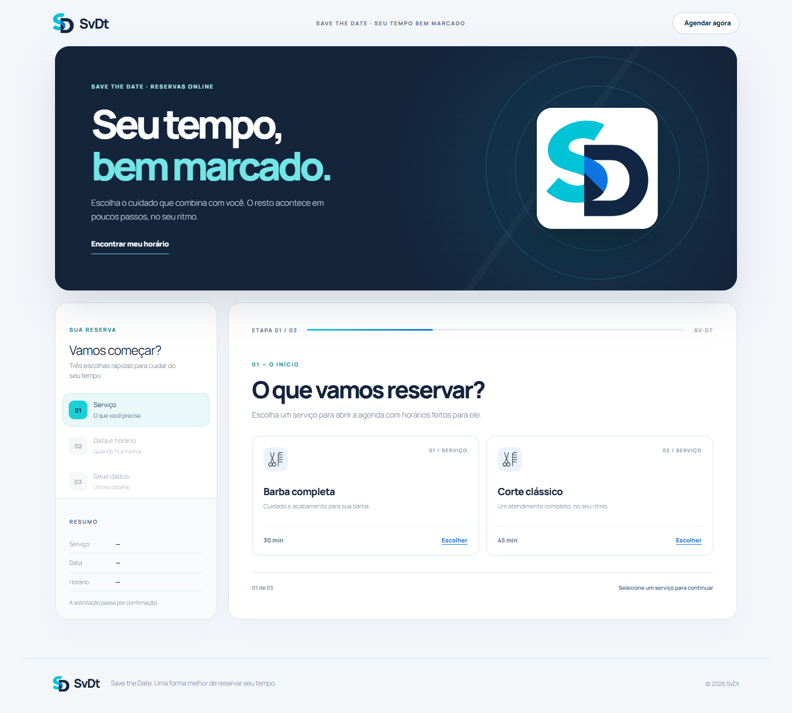
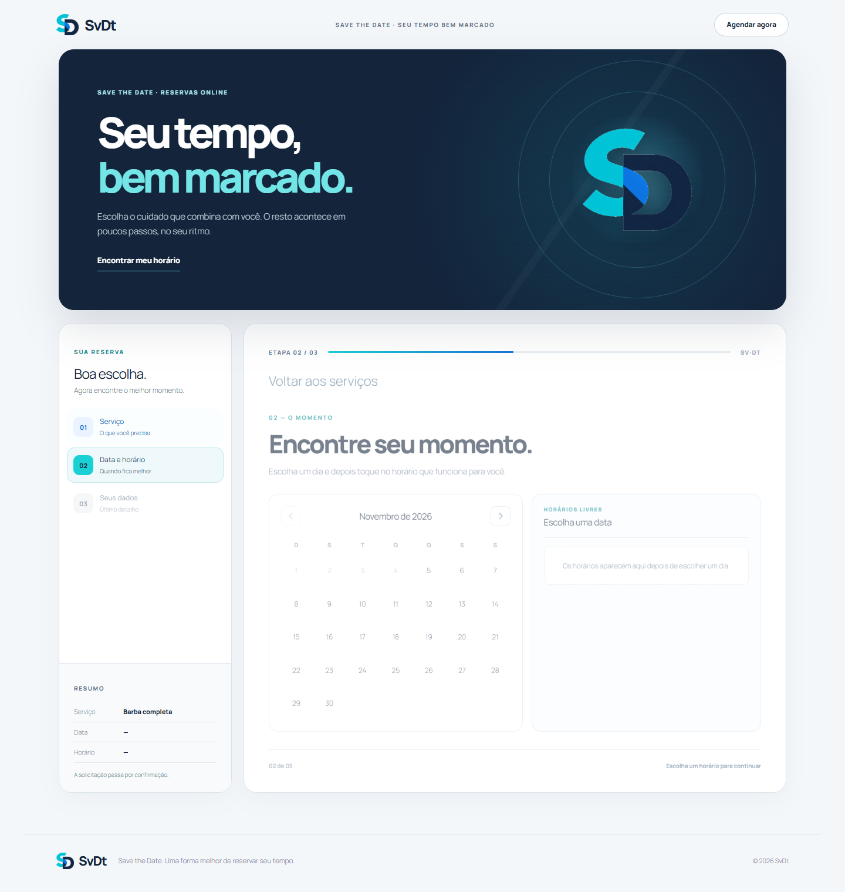
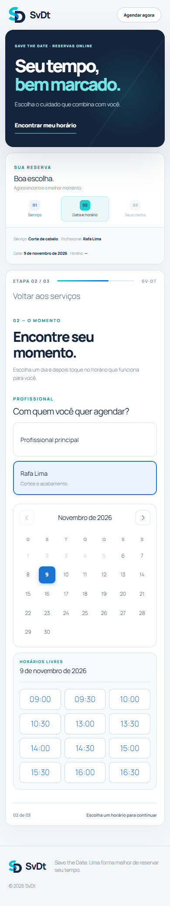
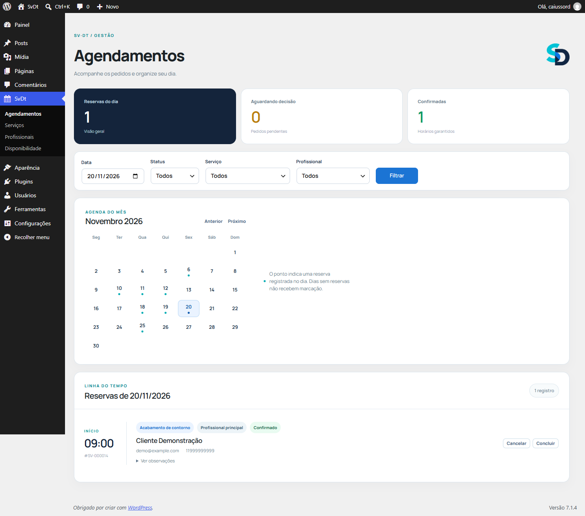

# SvDt — agendamento com uma experiência melhor

Plugin WordPress autoral demonstrativo para profissionais autônomos e pequenas equipes. O visitante escolhe serviço, profissional quando houver mais de uma opção, data e horário, e envia uma solicitação pendente. O painel permite organizar reservas, serviços, profissionais, expedientes e folgas.

**SvDt** vem de **Save the Date**. A identidade usa a marca e os ícones fornecidos para este projeto. Os cards de serviços usam ícones de barba, navalha, hidratação e lavagem conforme o atendimento. Confirme autoria, licença e eventuais créditos antes da publicação pública.

## Experiência

- No catálogo de demonstração, **Corte de cabelo** reúne estilos como clássico, degradê e social; o cliente informa a preferência nas observações. **Barba** aparece como um único serviço.
- A agenda aparece após a escolha do serviço e mostra apenas horários válidos para sua duração, dentro dos próximos 90 dias.
- Com um único profissional habilitado para o serviço, a escolha é automática. Com vários, o cliente escolhe antes de ver a agenda.
- Trocar de profissional limpa data e horário anteriores, evitando manter uma disponibilidade que já não corresponde à nova agenda.
- Um horário selecionado abre o formulário; voltar preserva as escolhas anteriores.
- O resumo e o indicador de progresso acompanham cada etapa.
- Estados de carregamento, vazio, erro e sucesso têm mensagens próprias.
- A página de demonstração usa o template opcional **SvDt · Página de reservas**. O shortcode continua funcionando em outros temas.
- Navegação por teclado, foco visível, labels e preferência por movimento reduzido.

Outras telas: [equipe no desktop](docs/screenshots/svdt-desktop-team.png), [profissionais no painel](docs/screenshots/svdt-admin-professionals.png), [serviço no celular](docs/screenshots/svdt-mobile-step1.png), [dados](docs/screenshots/svdt-mobile-step3.png), [confirmação](docs/screenshots/svdt-success.png), [serviços no painel](docs/screenshots/svdt-admin-services.png) e [expediente](docs/screenshots/svdt-admin-schedule.png).

## Funcionalidades da versão 2.0

- Serviços com duração, intervalo após atendimento, descrição e estado ativo.
- Profissionais com nome, descrição, estado ativo e ordem; cada um pode atender serviços diferentes.
- Expediente com múltiplos intervalos por dia, validado contra sobreposições dentro da mesma agenda.
- Folgas individuais e fechamento global do estabelecimento.
- Disponibilidade com antecedência mínima de 60 minutos e passos de 30 minutos.
- Solicitação pública com status pendente, validação no servidor, honeypot e limite de tentativas por IP; a tela de sucesso informa que ainda depende de confirmação.
- Bloqueio MySQL por profissional durante a nova verificação e gravação: duas pessoas podem receber reservas no mesmo horário sem conflito entre agendas.
- Painel com calendário mensal que marca os dias com reservas, filtros por data, status, serviço e profissional; ações de confirmação, cancelamento e conclusão.
- Endpoints REST públicos e administrativos.

## Instalação

Requisitos: WordPress 6.2+, PHP 8.0+ e MySQL com suporte a `GET_LOCK()`. Uma instalação nova cria um profissional padrão, que pode ser renomeado no painel.

1. Copie a pasta `svdt` para `wp-content/plugins/svdt/` e ative **SvDt** em **Plugins**.
2. Em **SvDt → Serviços**, cadastre os serviços.
3. Em **SvDt → Profissionais**, habilite os serviços de cada pessoa. Com apenas um profissional ativo, serviços novos são associados automaticamente a ele.
4. Em **SvDt → Disponibilidade**, configure o expediente de cada profissional. Sem intervalos ativos, não há horários livres. Use folgas individuais ou fechamento global conforme necessário.
5. Crie uma página com `[svdt_booking]`. Para reproduzir a demonstração, selecione o template **SvDt · Página de reservas** e defina a página como inicial.
6. Ajuste o fuso em **Configurações → Geral**. O plugin usa esse fuso para todas as reservas.

Na atualização da versão 0.3.x, faça backup do banco antes de substituir os arquivos. A versão 2.0 cria quatro tabelas novas, acrescenta `professional_id` às reservas e copia serviços, expediente e reservas existentes para um profissional padrão. As tabelas antigas de expediente e bloqueios globais permanecem. A migração é idempotente e verifica reservas sem profissional antes de marcar o esquema como atualizado. Consulte [migração e recuperação](docs/migration-v2.md). Para instalações ainda chamadas AgendaPro, a migração anterior para os nomes SvDt continua disponível.

Nesta instalação Local, a demonstração abre em **`http://localhost:10011/`** e o painel em **`http://localhost:10011/wp-admin/`**.

Após entrar no WordPress como administrador, use **SvDt → Agendamentos**, **Serviços**, **Profissionais** e **Disponibilidade** em `wp-admin/admin.php?page=svdt`. A área de gestão faz parte do painel WordPress; não é uma página pública separada.

## API

| Método | Rota | Acesso |
|---|---|---|
| GET | `/wp-json/svdt/v1/services` | Público |
| GET | `/wp-json/svdt/v1/professionals?service_id=1` | Público |
| GET | `/wp-json/svdt/v1/availability?service_id=1&professional_id=2&date=AAAA-MM-DD` | Público |
| POST | `/wp-json/svdt/v1/bookings` | Público |
| GET | `/wp-json/svdt/v1/admin/bookings` | Administrador |
| GET | `/wp-json/svdt/v1/admin/professionals` | Administrador |
| PATCH | `/wp-json/svdt/v1/admin/bookings/{id}` | Administrador |

O corpo do POST contém `service_id`, `professional_id`, `date`, `time`, `customer_name`, `customer_email`, `customer_phone` e `notes` opcional. Quando `professional_id` é omitido, a API escolhe automaticamente somente se existir um único profissional ativo habilitado para o serviço; se houver vários, retorna erro `professional_required` (HTTP 400). A resposta pública contém apenas `reference` e `status`. As edições administrativas de profissionais usam formulários autenticados com nonce no painel WordPress.

## Verificação

Validado no Local com WordPress 7.1.4, PHP 8.2.29 e MySQL 8.4.0. Antes da migração 2.0, foi gerado um backup local fora do repositório. A comparação posterior confirmou os IDs, dados, datas e status dos 7 serviços e 11 agendamentos existentes; todas as reservas ficaram ligadas ao profissional padrão. Reexecutar a migração não duplicou serviços, expediente ou reservas.

`tests/smoke-local.php` verificou o fluxo individual e as regras do MVP. `tests/team-local.php` criou e removeu uma equipe temporária; confirmou serviço incompatível, folga individual, duas reservas no mesmo horário para profissionais diferentes e conflito para o mesmo profissional. Requisições HTTP concorrentes produziram **201/409** na mesma agenda e **201/201** em agendas diferentes. O endpoint administrativo de profissionais respondeu **401** sem autenticação. No navegador, o cadastro de profissional, o expediente, a rejeição de intervalos sobrepostos e os fluxos público individual e em equipe passaram em desktop e celular. Os registros de teste foram removidos.

Uma instalação limpa isolada do WordPress ativou o plugin, criou o profissional padrão, exibiu horários e gravou uma solicitação. Ela usou o MySQL do Local com prefixo de tabelas separado; as tabelas de teste foram removidas. A validação em hospedagem real continua pendente; siga a [lista de verificação para homologação](docs/hosting-validation.md). Mudanças de horário de verão em fusos que as adotam não foram testadas.

Para reproduzir no Local: `wp eval-file tests/smoke-local.php` e `wp eval-file tests/team-local.php`. O segundo teste usa `node tests/team-concurrency-local.mjs` internamente e limpa seus dados ao terminar; ajuste `SVDT_PORT` se a porta local não for 10011. `tests/seed-local.php` prepara apenas a demonstração e não deve ser executado em uma instalação com dados reais. Com a tabela de reservas vazia, `wp eval-file tests/seed-showcase-local.php` cria cinco reservas fictícias para os profissionais já cadastrados, usando nomes naturais e contatos reservados para teste (`example.test`).

Os scripts de teste acompanham o repositório de desenvolvimento. O ZIP distribuível contém somente `svdt.php`, `uninstall.php`, `readme.txt`, `LICENSE`, `admin/`, `includes/` e `public/`, sob a pasta `svdt/`. Ele não inclui `.git`, testes, capturas, backups ou arquivos do ambiente Local.

## Privacidade e limites

Nome, e-mail, telefone e observações são armazenados para administrar a solicitação. Reservas canceladas e concluídas são removidas pelo WP-Cron após 12 meses. Reservas pendentes e confirmadas permanecem até que o administrador altere seu status. A desinstalação preserva dados por padrão; para apagá-los de forma irreversível, defina `SVDT_DELETE_DATA` como `true` no `wp-config.php` antes de desinstalar.

A versão 2.0 não oferece pagamentos, e-mails automáticos, integração com calendários, múltiplas unidades, atribuição automática entre vários profissionais ou reagendamento pelo cliente. Horas locais repetidas em mudanças de horário de verão exigem teste adicional antes do uso em fusos afetados.

Veja [arquitetura](docs/architecture.md) para as decisões técnicas. Este é um projeto demonstrativo, sem clientes reais. Licença GPL-2.0-or-later.
