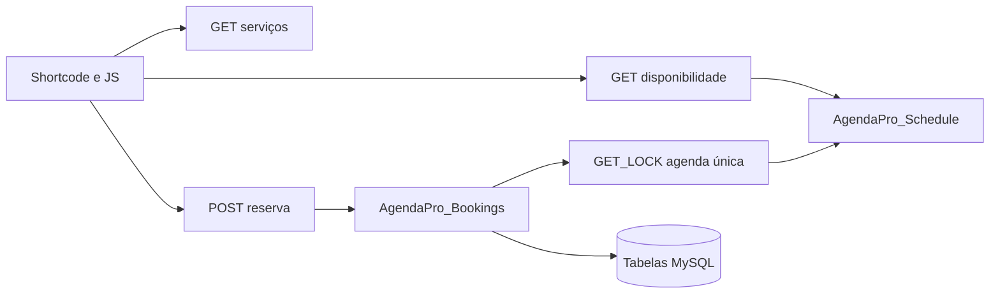

# Arquitetura do MVP

## Fluxo público

`AgendaPro_Schedule` consulta expediente, bloqueios e reservas pendentes/confirmadas. Para cada período, gera candidatos em passos configuráveis, verifica antecedência, duração mais intervalo e sobreposição. `AgendaPro_Bookings` valida a entrada, obtém um bloqueio MySQL para a agenda única, recalcula a disponibilidade e insere a reserva. A liberação do bloqueio ocorre em `finally`, inclusive em erros.

## Dados

- `agendapro_services`: catálogo e duração.
- `agendapro_business_hours`: múltiplos períodos por dia da semana.
- `agendapro_blocked_dates`: dias inteiros sem atendimento.
- `agendapro_bookings`: dados de contato, intervalo ocupado e estado.

Os nomes físicos recebem `$wpdb->prefix`. A migração é versionada pela opção `agendapro_db_version` e usa `dbDelta()`.

## Segurança e escopo

O REST administrativo exige `manage_options` e a autenticação normal do WordPress. As ações HTML do painel usam nonce e capacidade. O endpoint público tem honeypot e limite de oito tentativas por IP a cada dez minutos. A resposta pública de criação não inclui dados pessoais.

O MVP assume uma agenda/recurso. `GET_LOCK()` serializa criação de reservas no mesmo banco MySQL. Uma versão com múltiplos recursos precisará de uma chave de bloqueio por recurso e testes de concorrência para essa estrutura.
