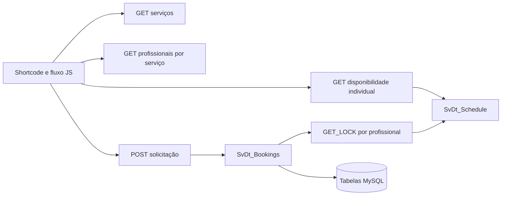

# Arquitetura do SvDt 2.0

## Fluxo público

Quando somente um profissional ativo atende o serviço, a interface o seleciona automaticamente. Com vários, ela exige a escolha antes de revelar o calendário. O backend aplica a mesma regra quando `professional_id` está ausente. Trocar serviço ou profissional invalida data e horário selecionados.

`SvDt_Schedule` consulta serviço ativo, vínculo, expediente individual, folga individual, fechamento global e reservas pendentes/confirmadas do profissional. Candidatos respeitam antecedência, 90 dias, duração mais intervalo, passo configurado e fuso do WordPress. `SvDt_Bookings` obtém um lock MySQL derivado do prefixo da instalação e do ID do profissional, recalcula a disponibilidade dentro dele e grava a solicitação. O lock é liberado em `finally`.

## Dados e migração

- `svdt_services`: catálogo, duração e intervalo.
- `svdt_professionals`: nome, descrição, estado e ordem.
- `svdt_professional_services`: vínculo muitos para muitos.
- `svdt_professional_hours`: períodos semanais por profissional.
- `svdt_professional_blocked_dates`: folgas individuais.
- `svdt_blocked_dates`: fechamentos globais.
- `svdt_bookings`: contato, intervalo, status e `professional_id`.
- `svdt_business_hours`: expediente legado, mantido para recuperação.

Os nomes físicos usam `$wpdb->prefix`. `dbDelta()` cria as novas estruturas e adiciona a coluna de reserva sem descartar dados existentes. Um profissional padrão recebe todos os serviços e períodos antigos; reservas históricas preservam seus IDs e status. A opção `svdt_professional_migration_complete` impede que uma reativação recopie vínculos removidos intencionalmente no painel. O esquema fica em `svdt_db_version`.

## Administração e segurança

O painel usa a capacidade `manage_options` e nonces. Os formulários de profissionais alteram dados e vínculos em uma transação. A inclusão de períodos semanais verifica sobreposição dentro de um lock da agenda. Folgas individuais e bloqueios globais têm formulários separados.

Os endpoints administrativos exigem a autenticação normal do WordPress e `manage_options`. Os públicos expõem apenas serviços, nomes e descrições dos profissionais, horários disponíveis e a referência/status da nova solicitação. A criação tem honeypot e limite de oito tentativas por IP a cada dez minutos. A atualização de status usa condição no `WHERE` para rejeitar operações baseadas em estado antigo.

Veja [migração e recuperação](migration-v2.md) para atualizar uma instalação existente.
